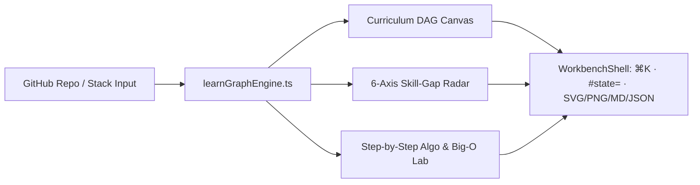

# learn-graph

[](https://aetherx86.github.io/learn-graph/)
[](#plugin-installation)
[](LICENSE)

> **Interactive Curriculum DAG, Repo-to-Roadmap Skill-Gap Mapper & Step-by-Step Algorithm / Memory / Big-O Lab** for `developer-roadmap`, `ossu/computer-science`, `build-your-own-x`, `freeCodeCamp`, and `TheAlgorithms`.

## Target GitHub Ecosystems

| Ecosystem | Capability in `learn-graph` |
| --- | --- |
| `kamranahmedse/developer-roadmap` | Pan/zoom prerequisite DAG with `localStorage` mastery progress and unlock indicators |
| `ossu/computer-science` | Full CS core graph from discrete math & Nand2Tetris to OS kernels and compilers |
| `codecrafters-io/build-your-own-x` | Skill-gap scanner recommends the highest-leverage scratch build (Shell, Git, Redis, SQLite, Docker, GPT) |
| `TheAlgorithms` & Interview Prep | Animated step-by-step QuickSort, Binary Search & Heapify with live Call Stack, Heap notes & Big-O curves |

## Architecture



## Quickstart

```bash
npm install
npm run dev
```

Run tests and production build:

```bash
npm test && npm run build
```

## Plugin Installation

1. **Chrome MV3 Extension (`plugin/`)**: Open `chrome://extensions`, enable **Developer Mode**, click **Load unpacked**, and select `./plugin`.
2. **CLI Companion**:
   ```bash
   node plugin/cli.mjs --demo
   ```

## License

[MIT](LICENSE)
